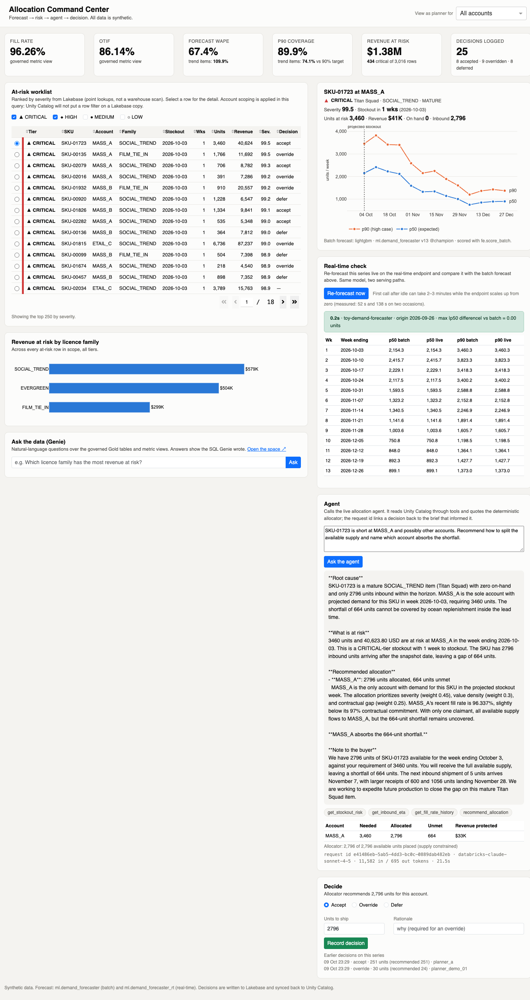

# Evidence 07 — Stage F: the Allocation Command Center

| | |
|---|---|
| Produced by | `app/{app,backend,settings,deploy}.py`, `tests/smoke_app.py` |
| App | `allocation-command-center` on Databricks Apps (Dash, Python 3.11 runtime) |
| URL | https://allocation-command-center-7474649643770783.aws.databricksapps.com |
| Runs as | its own service principal, `73bbee7a-df47-4bb9-b503-30e5b392657f` |
| Screenshot | [`evidence/screens/app_full.png`](screens/app_full.png) |



## 1. What it does

One page, in the order a planner works:

| Panel | Reads from | Why that store |
|---|---|---|
| KPI header | governed metric views (`mv_fill_rate`, `mv_otif`, `mv_forecast_accuracy`) via the SQL warehouse; risk totals and decision counts from Lakebase | KPIs have one definition, shared with Genie and the agent |
| At-risk worklist, revenue-by-family chart | Lakebase `public.stockout_risk_current` | low-latency point lookups, not a warehouse scan per page load |
| SKU detail + 13-week forecast chart | Lakebase `public.forecast_next_13w` | same |
| Real-time check | `toy-demand-forecaster`, input row from `ml.demand_features_weekly` | proves the two serving paths agree |
| Agent | `toy-allocation-agent` | explains, and quotes the deterministic allocator |
| Decide | **writes** `allocation.allocation_decisions` in Lakebase | the decision now exists somewhere it can be measured |
| Ask the data | Genie space `Demand & Allocation` | natural-language questions with the SQL shown |

Every external dependency is an app **resource** (SQL warehouse, two serving endpoints, a Genie
space, and the Lakebase Autoscaling database through `AppResourcePostgres`), injected with
`valueFrom`. `app/app.yaml` is rendered from `src/config.py` by `app/deploy.py`, so there is
still one place a name is defined.

## 2. Verification

### 2a. Backend smoke test against the live workspace — 10 of 10

`python tests/smoke_app.py`:

```text
PASS  warm-up: real-time forecaster         55.8s  forecaster answered in 52.5s
PASS  lakebase: ranked worklist              0.8s  250 rows, top SKU-01723/MASS_A
PASS  lakebase: account scoping              1.1s  997 rows
PASS  lakebase: 13-week forecast             0.8s  13 weeks, model v13
PASS  lakebase: totals                       0.7s  3,016 rows, $1,381,392 at risk
PASS  warehouse: governed KPIs               3.3s  fill 96.26 otif 86.14 wape 67.4 p90 89.9 (trend 74.1)
PASS  lakebase: decision write (rollback)    1.1s  insert ok (delta 2), rolled back, 25 rows remain
PASS  real-time forecast == batch            1.5s  max |p50 diff| = 0.000 units over 13 weeks
PASS  agent: tools return data              26.2s  tools [get_stockout_risk, get_inbound_eta, get_fill_rate_history, recommend_allocation], recommends 2796 units for MASS_A
PASS  genie: answers with SQL               20.2s  [['SOCIAL_TREND', '579003.64']] in 20.2s
```

The write check inserts and **rolls back**, so the test leaves no rows behind (a stray row would
also change the decision counts Genie reports).

### 2b. The deployed app, as its own service principal

The deployed app was driven over HTTP with an OAuth token, calling the same Dash callbacks the
page fires. Results:

| Callback | Result |
|---|---|
| KPIs | fill 96.26%, OTIF 86.14%, WAPE 67.4% (trend 109.9%), P90 coverage 89.9% (trend **74.1%**), $1.38M at risk, 25 decisions |
| Worklist | 250 rows from Lakebase, read by the app's Postgres role |
| Genie | SOCIAL_TREND, $579,003.64, with the SQL Genie wrote (matches the reference query) |
| Real-time check | live == batch, max p50 difference 0.00 units, 0.1 s once warm |
| Agent | answered from tool output: MASS_A needs 3,460, 2,796 available, 664 unmet |
| **Decide** | **decision recorded** (accept, 2,796 units) through the service principal's `INSERT` grant |

### 2c. The traceability chain, read back from Lakebase

The decision written by the deployed app and the agent call that informed it, before they were
removed as test rows:

```text
allocation_decisions   id 28  SKU-01723 / MASS_A  week 2026-10-03
                       recommended 2,796  planner 2,796  accept  model_version 13  severity 99.53
                       agent_trace_id 63e17ab3-dfcb-4854-9ffd-d32896f05b5d
agent_interactions     id 3   tools [get_stockout_risk, get_inbound_eta, get_fill_rate_history,
                              recommend_allocation]  16,030 in tokens  23.1 s
                       trace_id 63e17ab3-dfcb-4854-9ffd-d32896f05b5d      <- the same id
```

A decision can be traced to the brief the planner read, the model version in force, and the
severity at decision time. That is the argument for capturing it. Those four test rows were then
deleted by id (`decisions 26 -> 25`, `interactions 3 -> 0`) so the 25 seeded decisions Genie and
the KPIs report are unchanged.

## 3. What went wrong on the way, kept in

* **The deployed agent had never been able to read any data.** The agent's tools run as the
  serving endpoint's own identity, which only receives access to *declared* resources. The
  agent was logged with the LLM endpoint and the warehouse and nothing else, so every tool call
  returned `INSUFFICIENT_PERMISSIONS ... USE CATALOG`, and the model wrote a fluent refusal
  around it. The committed Stage C2 notebook export contained exactly that answer and it was
  not caught. The in-notebook evaluation ran as the developer and looked healthy.
  Fixed by declaring the seven tables as `DatabricksTable` resources, plus a notebook cell
  that **fails if any live tool call returns an error**. The app's agent panel now shows a
  red banner on a tool error rather than the prose around it.
* **One table stayed unreadable.** After declaring all seven, six worked and
  `gold.fct_stockout_risk` still returned `User does not have SELECT on Table`, although the
  app's service principal reads it fine. Declaring it first or last changed nothing; the cause
  was not isolated. The agent's tools now read it through `gold.v_stockout_risk`, a view with
  identical rows, which the endpoint can read. This is a workaround, labelled as one.
* **Forecaster cold start.** From scale-to-zero the real-time endpoint took **138 s** on one
  call and **52 s** on another. The app wakes it at start-up and the UI says so.
* **Smaller bugs found only by looking:** `html.Div(id=None)` crashed the first load; the
  Genie link rendered as `https://genie/rooms/...` when `DATABRICKS_HOST` was unset; the table
  used a monospace font; the agent's Markdown showed as raw `**` marks; the `refresh token`
  for the CLI profile expired mid-session and had to be re-authenticated.

## 4. Limits, stated

* **The deployed UI was not clicked through in a browser.** The workspace SSO login blocked
  the automation, and signing in as the user was not attempted. The deployed app was verified
  by calling its callbacks over HTTP with an OAuth token; the screenshot above is the same
  code running locally against the same live workspace.
* **Planner scoping is simulated.** The "View as planner for" selector filters the app's own
  query. Real per-user scoping would need on-behalf-of authorization mapped to a retailer, which
  was not built.
* **The decision is not written back to Unity Catalog by the app.** The existing writeback job
  (`src/lakebase/writeback.py`) syncs Lakebase decisions into `gold.fct_allocation_decisions`;
  it was not re-run here.
* **Light theme only.** The chart palette was validated on the light surface; dark mode would
  need its own selected steps.
* **Grants on the synced tables are lost whenever `sync.py` re-creates them.** Re-run
  `python app/deploy.py --grants` after any re-sync.
* The Flask development server is what Dash runs under here; acceptable for a demo, not for
  production.
