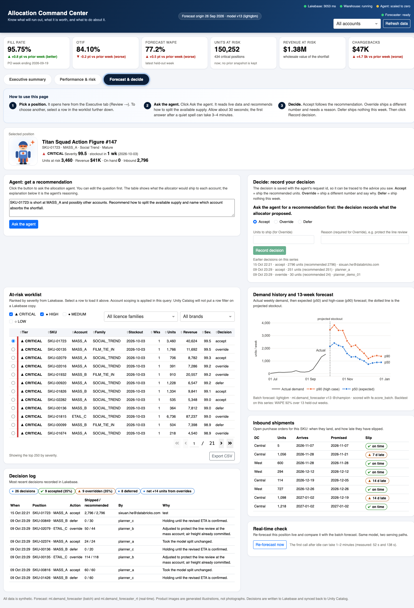
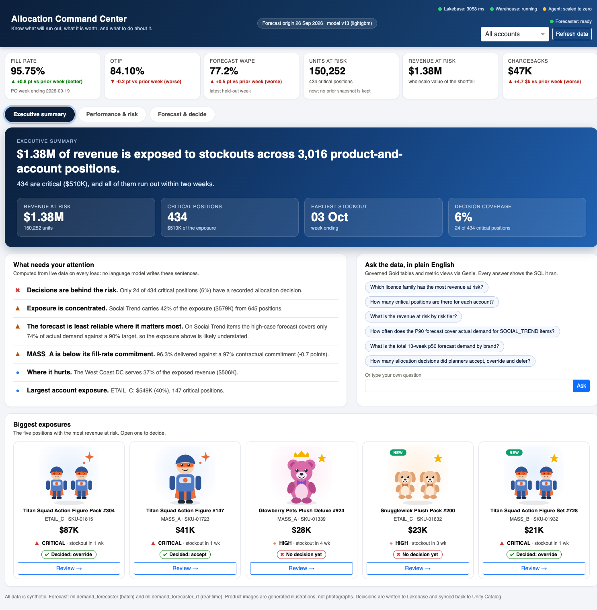
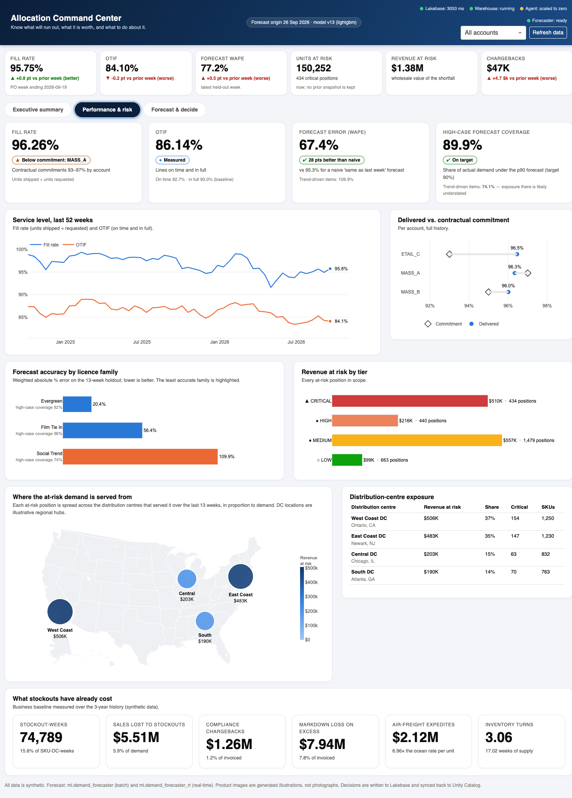
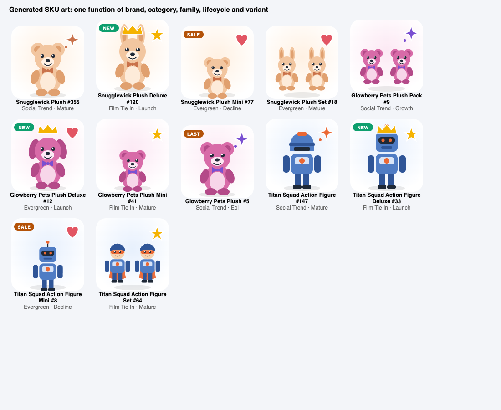

# Evidence 07 — Stage F: the Allocation Command Center

| | |
|---|---|
| Produced by | `app/{app,backend,ui,narrative,art,settings,deploy}.py`, `tests/{test_app_pure,smoke_app,smoke_deployed}.py` |
| Generated | 2026-10-15 (UTC) against https://fevm-stable-classic-pqjg18.cloud.databricks.com, catalog `toy_demand_allocation` |
| Status | `RUNNING` / compute `ACTIVE`; latest deployment `SUCCEEDED` |
| App | `allocation-command-center` on Databricks Apps (Dash, Python 3.11 runtime) |
| URL | https://allocation-command-center-7474649643770783.aws.databricksapps.com |
| Runs as | its own service principal, `73bbee7a-df47-4bb9-b503-30e5b392657f` |
| Genie | https://fevm-stable-classic-pqjg18.cloud.databricks.com/genie/rooms/01f1c8cc66d713fba1decec949c0740c |

Built for two audiences who use it every day: executives, who need the answer in one screen, and
operations managers, who need to act on it.

## 1. The header KPIs, then the three tabs

### KPI header (on every tab) — read from Lakebase

Six cards, as the build prompt specifies: **fill rate, OTIF, forecast WAPE, units at risk, revenue at risk**,
plus compliance chargebacks. Fill rate, OTIF and chargebacks come from the Lakebase `fill_rate_summary`
synced table, as ratios of sums over the account scope (never an average of percentages); units and revenue
at risk from `stockout_risk_current`. **Week-over-week deltas** show an arrow, the signed change and the
words *better* or *worse* (the direction that is good differs by metric: OTIF up is good, WAPE up is not).
Three things to know about the numbers:

* *Week* means **purchase-order week**. The order data has a PO week every second week, so "vs prior
  week" compares 2026-09-19 with 2026-09-05. The card says which week it is.
* The header fill rate (**95.75%**, one PO week) differs from the Performance tab's **96.26%** (full
  history). Both are correct and both are labelled.
* **Units and revenue at risk have no delta.** The pipeline keeps only the current risk snapshot, so there
  is no prior week to compare with. The card says so rather than inventing one. WAPE is the latest held-out
  week against the one before (a cached warehouse query; the rest of the header does not touch the warehouse).



## The three tabs

### Executive summary



* A **computed headline** and four hero metrics (revenue at risk, critical positions, earliest
  stockout, decision coverage).
* **What needs your attention**: ordered, plain-language findings, each with an icon and a label.
  Every sentence is a template filled with numbers just read from Lakebase or the metric views
  (`app/narrative.py`), so it cannot drift from the dashboards or invent a figure. No language
  model writes them.
* **Ask the data, in plain English**: six suggested questions plus free text, answered by Genie with
  the SQL shown. All six suggested questions were scored against reference SQL before being offered
  (`evidence/06_genie.md`, 15 questions).
* **Biggest exposures**: the five largest positions with generated product art, a status chip, and a
  **Review →** button that opens that exact SKU in the decision workspace.

### Performance & risk



KPI cards with status chips; a 52-week fill-rate and OTIF trend; delivered fill rate against each
account's contractual commitment (dumbbell); forecast accuracy by licence family with the least
accurate highlighted; revenue at risk by tier in the reserved status colours; **a map of where the
at-risk demand is served from**, with a matching table; and the already-incurred business cost
(Stage B baseline).

### Forecast & decide


Laid out in the order a person works. A **"How to use this page"** strip gives three plain steps
(pick a position, ask the agent, decide). Below it the **selected position** (image and facts), then
**Agent** and **Decide** side by side at the top: the agent leads with the allocation table (what
would ship to each account) and puts its longer reasoning in a scrolling box; the decide card
explains Accept, Override and Defer in one line each and labels the fields ("Units to ship (for
Override)", "Reason (required for Override)"). Underneath: the ranked worklist (filter by tier, licence family and **brand**, sort, export CSV), the
**demand history and 13-week forecast** (actual weekly demand, then p50 and p90, the stockout week marked, and the
backtest WAPE for that series), the **inbound shipments** table (open ASNs with arrival date, original promise and slip),
the real-time check, and the decision log. The agent panel shows the **trace id** of the serving request, which is also
stored on the decision.

## 2. Design decisions

| Decision | Why |
|---|---|
| Headline and insights are computed, not generated | A wrong sentence in front of a C-level is worse than a missing one. The agent scored ~74% on numeric grounding; a template scores 100% by construction. Unit-tested. |
| Fill-rate status checks **every account**, not an average | A first version said "At or above commitment" on the blended 96.26% while MASS_A (96.3%) was below its 97% commitment. An averaged commitment is meaningless to a retailer. |
| Status = colour **and** icon **and** label | Never colour alone. Tier colours are the reserved status steps; the two series colours were validated with `validate_palette.js` (adjacent CVD dE 24.7, normal-vision dE 33.6). |
| Honest KPI wording | The high-case coverage card shows 89.9% "On target" *and* the 74.1% on trend-driven items beside it, because that is where the exposure is understated. |
| Map: attribution from the demand fact's own DC grain | Each at-risk position is spread over the DCs that served it in the last 13 weeks, in proportion to unconstrained demand. **The four DC values sum to $1,381,392, exactly the total revenue at risk** (tested), so the method neither creates nor loses revenue. DC coordinates are illustrative regional hubs. |
| Product art generated from SKU attributes | Every SKU gets a consistent picture at zero storage cost. See §3. |
| Tab content loads lazily and is cached; start-up warms caches | The first Performance load runs warehouse queries; the cache means a user pays that once. |
| Four Lakebase tables, each with a reader | `stockout_risk_current` (worklist, risk totals), `forecast_next_13w` (forecast), `product_lookup` (names, categories, brand filter, art), `fill_rate_summary` (header KPIs). The warehouse is used only for the governed metric views, demand history and inbound ETAs, all cached. |
| Production touches | `/healthz`, live service-status dots (Lakebase, warehouse, agent, forecaster) including "scaled to zero", a Refresh button, CSV export, print stylesheet, loading states, an error banner per panel instead of a blank, and graceful degradation when the warehouse is unavailable. |

## 3. Generated SKU art



`app/art.py` renders an SVG as a pure function of the SKU's attributes: **category** decides the toy
(plush animal or action figure), **brand** the palette, **sku_id** the variant (bear, bunny, cat, pup;
robot, hero, knight), **licence family** the badge (star, sparkle, heart), **lifecycle** a ribbon
(NEW, SALE, LAST), and the source name's variant word a presentation (Deluxe crown, Mini size, Set or
Pack as two toys). It is illustrative, not photography; production would swap `sku_svg` for the real
asset URL.

**A data-quality finding shaped this.** The synthetic catalog's product names are independent of
their category: "Titan Squad Plushie 147" is an `ACTION_FIGURE`, and about half of all names
disagree with their category. Using the name to pick the picture would have shown a robot beside the
caption "Plushie". The art follows `category`, and the on-screen caption is derived from `category`
too ("Titan Squad Action Figure #147"); the source name stays in the image tooltip. A unit test pins
this.

## 4. Verification

### 4a. Unit tests — 14 of 14 (`python tests/test_app_pure.py`, no network)

The narrative (headline, totals, partial and empty cases, which insights fire and which must not), the KPI
status rules including the every-account fill check, the week-over-week delta wording and direction (up is
better for OTIF, worse for WAPE, flat, and no prior week), and the art (valid XML, deterministic, follows
category, caption agrees with picture, badges and ribbons, unknown brand still renders).

### 4b. Backend smoke test against the live workspace — 20 of 20 (`python tests/smoke_app.py`)

Stdout, committed as `evidence/metrics/smoke_app.txt`:

```text
PASS  warm-up: real-time forecaster          3.4s  forecaster answered in 0.2s
PASS  lakebase: ranked worklist              0.8s  250 rows, top SKU-01723/MASS_A
PASS  lakebase: account scoping              1.0s  997 rows
PASS  lakebase: 13-week forecast             0.7s  13 weeks, model v13
PASS  lakebase: totals                       0.7s  3,016 rows, $1,381,392 at risk
PASS  warehouse: governed KPIs               2.9s  fill 96.26 otif 86.14 wape 67.4 p90 89.9 (trend 74.1)
PASS  lakebase: KPI header + WoW             1.5s  fill 95.75% (+0.82 pt vs 2026-09-05), otif 84.10%, $1,381,392 / 150,252 units at risk
PASS  lakebase: worklist brand filter        1.5s  3 brands; Glowberry Pets: 214 rows
PASS  lakebase: product_lookup               1.5s  2,400 SKUs, masked columns present: none
PASS  SKU detail: actuals + inbound ETAs     1.9s  14 weeks actuals, backtest WAPE 92%, 8 open inbound shipments
PASS  executive aggregates                   0.8s  434 critical, $1,381,392 at risk, top SKU-01815
PASS  performance trends                     3.3s  52 weeks, fill 95.8% otif 84.1%
PASS  DC exposure conserves revenue          1.5s  4 DCs sum to $1,381,392 vs total $1,381,392
PASS  catalog attributes for art             0.7s  Titan Squad Plushie 147
PASS  service status                         1.1s  Lakebase=ok, Warehouse=ok, Agent=idle, Forecaster=ok
PASS  business baseline snapshot             0.0s  26 baseline KPIs
PASS  lakebase: decision write (rollback)     1.0s  insert ok (delta 2), rolled back, 26 rows remain
PASS  real-time forecast == batch            1.4s  max |p50 diff| = 0.000 units over 13 weeks
PASS  agent: tools return data              28.0s  tools ['get_stockout_risk', 'get_inbound_eta', 'get_fill_rate_history', 'get_fill_rate_history', 'get_fill_rate_history', 'recommend_allocation'], recommends 2796 units for MASS_A, request d733c138
PASS  genie: answers with SQL               14.3s  [['SOCIAL_TREND', '579003.6400000001']] in 14.3s

20/20 passed
```

### 4c. The deployed app, over HTTP — 9 of 9 (`python tests/smoke_deployed.py`)

Drives the running app the way a browser does: GET the page, then POST the same `/_dash-update-component`
requests the page fires, with an OAuth token (workspace SSO blocks a headless browser). Each line has the HTTP
status and latency. The write is proved with **pre and post row counts** read straight from Lakebase, then the one
decision the test created is deleted by id so the seeded rows are unchanged. Stdout
(`evidence/metrics/smoke_deployed.txt`):

```text
2026-10-15 16:17:59,114 [acc] loading vm-summer-classic profile from ~/.databrickscfg: host, serverless_compute_id, auth_type, account_id, workspace_id
2026-10-15 16:18:00,143 [acc] Using Databricks CLI authentication
app https://allocation-command-center-7474649643770783.aws.databricksapps.com
profile vm-summer-classic

PASS  HTTP 200     0.4s  GET /healthz                     0-byte body (answered by the platform proxy)
PASS  HTTP 200     0.4s  GET / (dash page)                5,832 bytes
PASS  HTTP 200     0.9s  header KPIs (Lakebase)           Fill rate | 95.75% | ▲ +0.8 pt vs prior week (better) | PO week ending 2026-09-19 | OTIF | 84.10% | ▼ -0.2 pt vs prior week (worse) | Forecast WAPE | 
PASS  HTTP 200     0.6s  worklist, brand filter           250 rows, all Snugglewick
PASS  HTTP 200     2.3s  SKU detail: actuals, ETAs        series ['Actual demand', 'p90 (high case)', 'p50 (expected)']; inbound: DC | Units | Arrives | Promised | Slip | Central | 5 | 2026-11-07 | 20
      pre : allocation_decisions=26 (max id 33), agent_interactions=1
PASS  HTTP 200    18.7s  Genie question (chip)            You asked:  | What is the revenue at risk by risk tier? | Revenue at risk is highest in **MEDIUM** at **$556,576.44**, followed by **CRITICA
PASS  HTTP 200    25.9s  agent call (serving endpoint)    recommends 2796 units; request id 59c470ea-21fb-41c3-8f1a-b8165926322e
      post: allocation_decisions=27 (max id 39)
PASS  HTTP 200     0.6s  decide -> Lakebase INSERT        Decision #39 recorded |  — accept, 2,796 units (+0 vs recomm; rows 26 -> 27; trace id carried: True
      cleanup: deleted decision #39 and its interaction; decisions=26, interactions=1
PASS  cleanup restored the pre-test counts

9/9 passed
```

The decision carries the agent's trace id (`trace id carried: True`), so it can be traced back to the brief the
planner read.

### 4d. `app.yaml` and resource bindings

```yaml
# Rendered by app/deploy.py from src/config.py. Edit the config, not this file.
command: ["python", "app.py"]

env:
  # resources: the platform injects these, nothing is hardcoded
  - name: DATABRICKS_WAREHOUSE_ID
    valueFrom: sql-warehouse
  - name: AGENT_ENDPOINT
    valueFrom: agent-endpoint
  - name: FORECASTER_ENDPOINT
    valueFrom: forecaster-endpoint
  - name: GENIE_SPACE_ID
    valueFrom: genie-space
  # Lakebase coordinates (not secrets; the credential is minted at runtime)
  - name: PG_HOST
    value: "ep-empty-butterfly-d2dihd0i.database.us-east-1.cloud.databricks.com"
  - name: PG_DATABASE
    value: "databricks_postgres"
  - name: PG_ENDPOINT
    value: "projects/toy-demand-alloc/branches/production/endpoints/primary"
  - name: UC_CATALOG
    value: "toy_demand_allocation"
  # wake the scale-to-zero forecaster at start-up (it takes minutes to come up)
  - name: WARMUP
    value: "1"
```

Resources bound to the app (its own service principal `73bbee7a-df47-4bb9-b503-30e5b392657f`), from
`WorkspaceClient.apps.get`:

| Name | Type | Permission |
|---|---|---|
| `sql-warehouse` | SQL warehouse `a6857db5911f7af1` | CAN_USE |
| `agent-endpoint` | serving endpoint `toy-allocation-agent` | CAN_QUERY |
| `forecaster-endpoint` | serving endpoint `toy-demand-forecaster` | CAN_QUERY |
| `genie-space` | Genie space `Demand & Allocation` (`01f1c8cc66d713fba1decec949c0740c`) | CAN_RUN |
| `lakebase` | Postgres branch `projects/toy-demand-alloc/branches/production`, database `databricks-postgres` | CAN_CONNECT_AND_CREATE |

Postgres grants for the service principal: `SELECT` on the four synced tables, `SELECT, INSERT` on
`allocation.allocation_decisions` and `allocation.agent_interactions`.

### 4e. App log from a real session

`databricks apps logs allocation-command-center`, the application's own lines from the run in 4c (client addresses
removed; full excerpt in `evidence/metrics/app_log_session.txt`). It shows the page load, the serving-endpoint call,
the Genie call and the two Lakebase INSERTs:

```text
2026-10-15T23:17:56Z [APP] 2026-10-15 23:17:56,812 [acc] Dash is running on http://0.0.0.0:8000/
2026-10-15T23:18:01Z [APP] 2026-10-15 23:18:01,452 [acc] 127.0.0.1 - - [15/Oct/2026 23:18:01] "GET / HTTP/1.1" 200 -
2026-10-15T23:18:05Z [APP] 2026-10-15 23:18:05,773 [acc] serving endpoint toy-allocation-agent answered in 1775 ms (request id 1316b164-3f82-4b15-8181-6f379b06159c)
2026-10-15T23:18:25Z [APP] 2026-10-15 23:18:25,750 [acc] genie space 01f1c8cc66d713fba1decec949c0740c answered in 18.3s, 4 rows, sql=True
2026-10-15T23:18:51Z [APP] 2026-10-15 23:18:51,601 [acc] serving endpoint toy-allocation-agent answered in 25470 ms (request id 59c470ea-21fb-41c3-8f1a-b8165926322e)
2026-10-15T23:18:51Z [APP] 2026-10-15 23:18:51,648 [acc] lakebase INSERT allocation.agent_interactions trace_id=59c470ea-21fb-41c3-8f1a-b8165926322e tools=['get_stockout_risk', 'get_inbound_eta', 'get_fill_rate_history', 'recommend_allocation']
2026-10-15T23:18:52Z [APP] 2026-10-15 23:18:52,221 [acc] lakebase INSERT allocation.allocation_decisions decision_id=39 SKU-01723/MASS_A action=accept planner_units=2796 recommended=2796 trace_id=59c470ea-21fb-41c3-8f1a-b8165926322e
```

### 4f. In the browser (local run of the same code against the live workspace)

The screenshots above come from the same code running locally against the same workspace. Clicking a
**Review →** card switches to *Forecast & decide* with that SKU selected; the KPI header, the demand history
chart with the stockout line and the inbound table all render for the selected SKU (see the screenshot).

## 5. What went wrong on the way, kept in

* **The deployed agent had never been able to read any data.** Its tools run as the serving
  endpoint's own identity, which only receives access to *declared* resources; the agent was logged
  without the tables, so every tool call returned `INSUFFICIENT_PERMISSIONS` and the model wrote a
  fluent refusal around it. Fixed by declaring the tables, plus a notebook cell that fails if any
  live tool call returns an error, and a red banner in the app. One table
  (`gold.fct_stockout_risk`) stayed unreadable to the endpoint although declared; the cause was not
  isolated, and the agent reads it through the view `gold.v_stockout_risk` (a workaround).
* **A KPI chip contradicted the executive page.** "At or above commitment" next to MASS_A being
  below its commitment (see §2). Caught by looking at the rendered page, then fixed and unit-tested.
* **The first map projection rendered blank.** Explicit longitude/latitude ranges and mercator
  variants produced empty axes in this plotly build; the default Albers USA works.
* **Bootstrap's `.lead` class** silently enlarged the insight headings; renamed.
* **A stale selection.** After "Review →", the worklist radio still pointed at row 1 while the panel
  showed another SKU; the radio is now cleared.
* **Cold starts.** Forecaster from zero: 52 s and 138 s. **Agent from zero: 217 s.** The app wakes
  both at start-up and the UI says so.
* **Two bugs only the deployed test caught.** The SKU-detail callback returned HTTP 500 because the forecast query
  did not select `origin_week` (visible in `databricks apps logs` as a `KeyError`), and my first deployed Genie check
  posted the callback in the wrong shape (it has a pattern-matching input and two outputs), so it returned HTTP 500
  until the test was fixed. The local checks had not exercised either.
* **`/healthz` is answered by the platform proxy**, not by the app: it returns an empty 200, so the in-app route is
  shadowed. The test checks the status code only.
* **The test shipped with a wrong assumption**: it required 20 weeks of actuals, but the top SKU is a recent launch
  with 14. The threshold was an error in the test, not a defect in the app.
* **My own test bugs:** a smoke check read the wrong key (`revenue` vs `rev`); a unit test had a
  vacuous `... or True` assertion. Both were found and replaced with real checks.

## 6. Limits, stated

* **The deployed UI was not clicked through in a browser** (workspace SSO blocks the automation);
  it was verified over HTTP (4c), and the screenshots come from the same code running locally against
  the same live workspace.
* **Product images are generated illustrations**, and DC locations are illustrative hubs.
* **The business-cost tiles are a dated snapshot** (Stage B, measured 2026-10-08, shipped with the
  app), not a live query.
* **Planner scoping is simulated** (a dropdown filtering the app's own query); real per-user scoping
  needs on-behalf-of authorization mapped to a retailer.
* **Lakebase holds one more decision than Unity Catalog** (id 33, rationale "test", recorded by hand while
  testing the app). It reaches `gold.fct_allocation_decisions` when the write-back job next runs; `02b_lineage.md` §6.
* **Units and revenue at risk have no week-over-week delta** (no prior snapshot is kept), and the header's
  "week" is a purchase-order week, two weeks apart.
* **Decision coverage reads 6%** because the 25 seeded decisions are the only ones; that is the
  data, not a defect, but it will look alarming to a first-time viewer.
* **The app does not write decisions back to Unity Catalog**; the existing writeback job does, and it
  was not re-run.
* **`stockout-weeks` appears as a baseline tile, not a live card** (it comes from the dated Stage B baseline).
* **Light theme only; Flask development server** under Dash. Grants on the synced tables are lost
  when `sync.py` re-creates them: re-run `python app/deploy.py --grants`.
